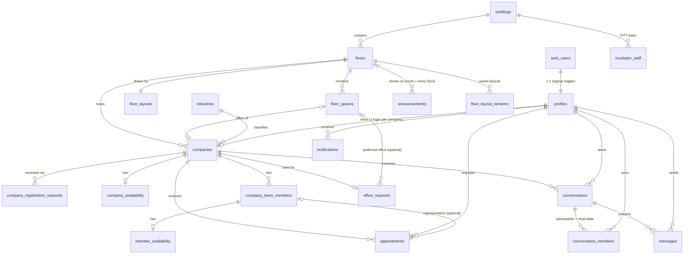

# Architecture

Startup Floor Connect is an interactive 2D virtual floor for an incubator building. Visitors explore an
SVG floor plan, discover the companies in each office, and contact them by chat, email or appointment
request.

## Stack

| Concern     | Choice                                                                      |
| ----------- | --------------------------------------------------------------------------- |
| Framework   | Next.js 16 (App Router, Cache Components, `proxy.ts`), React 19, TypeScript |
| Styling     | Tailwind CSS 4 with semantic design tokens (`src/app/globals.css`)          |
| Data / auth | Supabase: Postgres, Auth, Realtime, Storage                                 |
| Email       | Resend (server-side only)                                                   |
| Floor plan  | SVG rendered from database-stored geometry                                  |
| Tests       | Vitest; database tests run the real migrations on PGlite (Postgres in WASM) |
| Hosting     | Vercel + Supabase Cloud                                                     |

## Request flow

```
Browser ──► proxy.ts (refresh Supabase session cookie; optimistic only)
        ──► Server Components / Server Actions / Route Handlers
              └─ Supabase server client (user's JWT → RLS enforced)
              └─ Supabase admin client (secret key, server-only; used sparingly, caller authorized first)
        ──► Client Components
              └─ Supabase browser client (publishable key → RLS enforced)
              └─ Realtime subscriptions (messages, notifications, availability)
```

**Authorization lives in the database.** Every table has Row Level Security, and guard triggers protect
privileged columns. UI role checks only decide what to show; they are never the security boundary.

## Folder structure

```
supabase/
  config.toml              local Supabase settings (auth policy, redirect URLs)
  migrations/              ordered SQL migrations (schema → security → storage/realtime → feature RPCs)
  seed.sql                 local reference data: building, floor, layout, spaces, industries
scripts/
  generate-db-types.mts    offline type generator (migrations → src/types/database.ts)
src/
  app/                     routes (App Router)
    (public)/              floor map, directory, company profiles          [Phase 3–4]
    (auth)/                login, register, company registration          [Phase 2]
    account/               visitor area: conversations, appointments      [Phase 6–7]
    company/               company dashboard: profile, team, inbox        [Phase 3–7]
    admin/                 super admin dashboard                          [Phase 3–4]
    api/                   route handlers (health, email)
  components/
    ui/                    design-system primitives (button, input, badge, dialog …)
    layout/                header, footer, shells
    floor/                 SVG floor renderer, office shapes, zoom/pan    [Phase 4]
    company/ chat/ appointments/ admin/   feature components
  config/                  static app config (site metadata)
  lib/
    env.ts / env.server.ts validated environment (public vs server-only)
    supabase/              browser, server, admin and proxy clients
    floor/                 geometry schema + helpers
    auth/ companies/ appointments/ chat/  server-side data access + actions per feature
  types/database.ts        generated database types
  proxy.ts                 session refresh (Next 16 replacement for middleware)
tests/
  unit/                    pure TypeScript tests
  db/                      migration + RLS tests against PGlite
docs/                      architecture, checklist
```

## Data model



Key decisions:

- **Floors are data.** `floor_layouts.geometry` holds walls, corridors, common areas and entrances;
  `floor_spaces` holds every clickable space with its shape. Both are validated by
  `src/lib/floor/geometry.ts`. Adding a floor or building needs no code change.
- **One login per company.** `companies.owner_id` is unique. Team members are records the company
  manages, not accounts.
- **Placement integrity.** `companies.space_id` is unique (one company per office). A composite foreign
  key `(space_id, floor_id)` keeps the space on the company's floor, and a trigger only allows `office`
  spaces.
- **Availability is self-reported.** No availability row means _Unknown_. Rows carry `updated_at` and
  `updated_by`. Availability never implies a confirmed slot or physical presence.
- **Appointments.** Stored as UTC `starts_at` / `ends_at`, plus the requester's IANA `timezone` for
  display. Duration is 15 min to 4 h. A GiST exclusion constraint prevents overlapping **accepted**
  appointments for the same representative. A trigger enforces the status workflow (below).
- **Chat.** One conversation per (visitor, company). `conversation_members` holds the participants
  and their `last_read_at`, which gives unread counts. It also lets more company users join later
  without schema changes. Message timestamps are set by the server.
- **Notifications.** Written only by database triggers and server code; users can read them, mark
  them read, and delete them.
- **Startup profile (4R.5).** `companies.stage` (`idea` → `growth`), `team_size` and `tech_stack`
  (≤ 20 labels of ≤ 40 characters) are edited by the owner like the rest of the profile.
- **FITT Incubation Team.** `incubator_staff` are the incubator's own people, not company team members:
  admin-managed, shown at Reception and in the building overview. `is_public = false` hides one.
- **Announcements.** Admin-only. `floor_id` null means every floor. Visitors only ever read the ones
  running now (`starts_at ≤ now < ends_at`, or no end); the admin sees scheduled and finished ones too.
- **Office requests.** One row per company (`company_id` is the key): a preferred office or any, plus
  a note. A trigger only accepts approved companies without an office and only `office` spaces.
  Placing the company deletes its request; an admin closing it notifies the company
  (`office_request_closed`).

## Roles and permissions

| Role          | How assigned                                                  |
| ------------- | ------------------------------------------------------------- |
| Guest         | No session (`anon`)                                           |
| `visitor`     | Default at signup                                             |
| `company`     | Signup with `account_type: "company"` metadata                |
| `super_admin` | Manually, via SQL or service role. Never via signup metadata. |

| Resource                 | Guest                   | Visitor                 | Company account                              | Super admin         |
| ------------------------ | ----------------------- | ----------------------- | -------------------------------------------- | ------------------- |
| Floors, layouts, spaces  | read                    | read                    | read                                         | full                |
| Companies                | read approved           | read approved           | read approved + own; edit own*               | full                |
| Team / availability      | read (approved)         | read (approved)         | manage own                                   | full                |
| Registration requests    | –                       | –                       | submit + read own                            | review              |
| Profiles                 | –                       | own (+ contacts)        | own + people who contacted it                | read all, set roles |
| Conversations / messages | –                       | own only                | own company's only                           | **no access**       |
| Appointments             | –                       | own; cancel             | own company's; accept/reject/complete/cancel | read, manage        |
| Notifications            | –                       | own                     | own                                          | own                 |
| FITT team, announcements | read (public / running) | read (public / running) | read (public / running)                      | full                |
| Office requests          | –                       | –                       | own: send, change, withdraw                  | read, close         |
| Storage (logos, avatars) | public URLs             | public URLs             | write `<company_id>/…` folder                | full                |

\* Owners cannot change `status`, `slug`, `owner_id`, `floor_id` or `space_id`. Those are reserved
for super admins, and a guard trigger enforces it. New companies are always created as `pending`.

Appointment status workflow (trigger-enforced):

```
            company accepts          company completes (after start)
 pending ───────────────► accepted ─────────────────────────────► completed
    │  company rejects        │
    ├──────────► rejected     │ company or requester cancels
    │ requester cancels       ▼
    └──────────────────────► cancelled
```

## Floor map

```
page.tsx (server) ── getFloorPlan(?floor) ──► floors, layout, spaces, approved placed companies, industries
   └─ FloorExplorer (client)
        ├─ useMapViewport   zoom/pan state + gestures (pure maths in lib/floor/viewport.ts)
        ├─ FloorMap         SVG drawing only: areas → spaces → walls → entrances
        └─ ExplorerPanel    list (search, industry) or details of the selected space
```

- **Data-driven:** nothing about the floor is hard-coded in components. The drawing comes from
  `floor_layouts` and `floor_spaces`, and the occupants come from `companies.space_id`.
- **Rendering layers:** base (floor, zones) → room fills → details (furniture, walls, windows, doors) → zone
  labels → interactive room overlays. The static layers are memoised, so zooming only re-renders the overlays.
- **Zoom and pan:** these change the SVG `viewBox` (the visible rectangle of floor coordinates), so text
  stays sharp. The viewBox keeps the container's aspect ratio. Zoom is limited to 1–4×, and panning
  stops at the edges of the floor.
- **Selection lives in the URL:** `?company=<slug>`, `?space=<code>` or `?area=<key>`, updated with
  `history.pushState`. Deep links and the back button work, and the floor data isn't reloaded.
- **Admin placement:** `/admin/floor` reuses the same map. A company can only move into a vacant
  office, because `companies.space_id` is unique (no swaps). A trigger notifies the company whenever
  its office changes.

### Adding or editing a floor

1. Insert a `floors` row (building, name, slug, level).
2. Insert its `floor_layouts` row. `width` and `height` define the coordinate space, and `geometry` is:

   ```json
   {
     "walls": [
       {
         "points": [
           [20, 20],
           [1180, 20],
           [1180, 780],
           [20, 780]
         ],
         "closed": true
       }
     ],
     "areas": [
       {
         "key": "corridor",
         "kind": "corridor",
         "label": "Corridor",
         "shape": { "type": "rect", "x": 40, "y": 340, "width": 1120, "height": 120 }
       }
     ],
     "entrances": [
       {
         "key": "main",
         "label": "Main Entrance",
         "x": 1010,
         "y": 780,
         "width": 80,
         "orientation": "horizontal"
       }
     ]
   }
   ```

   Area kinds: `corridor`, `lounge`, `pantry`, `restroom`, `stairs`, `lift`, `lift_lobby`,
   `phone_booth`, `storage`, `event`, `terrace`, `other`. Areas may carry
   `info: { "description": "…", "amenities": ["…"] }`.

   **Geometry v2 (Phase 4R), all optional:**
   - `walls[].kind`: `exterior` | `interior` | `glass`, with an optional `thickness`.
   - `doors[]`: `{ x, y, width, orientation, swing: 1 | -1, hinge: "start" | "end", kind: "single" | "double" | "sliding" | "opening" }`.
     The opening runs from (x, y) along the wall; `swing` is the side the leaf opens towards.
   - `windows[]`: `{ x, y, length, orientation }`, on exterior walls.
   - `fixtures[]`: `{ kind, x, y, width, height, rotation: 0 | 90 | 180 | 270, seat? }`. The kinds are listed in
     `fixtureKindSchema` and drawn from `src/components/floor/floor-symbols.tsx` at the size given. Decorative,
     except that a workstation chair with a `seat` number shows the office's public team member at that
     position (seat 1 = first member in team order).

   Floor 1's drawing is generated from `src/lib/floor/layouts/floor-1.ts` (40 units = 1 m). The same JSON is
   in `seed.sql` and migration `20261017090000`, and a unit test keeps the three in sync. To change an existing
   floor, update `floor_spaces` rows **in place** (matched by code), never delete and re-insert them:
   `companies.space_id` is `on delete set null`.

   Edit an existing floor at **`/admin/floor/editor`**: the whole floor as one JSON document
   (`width`, `height`, `geometry`, and `spaces` = each space's shape by code), with a live preview,
   errors that block saving and warnings that don't. Saving calls `save_floor_layout()`, which applies
   the document in one transaction, updates space shapes in place (ids are kept), refuses a save made
   from an outdated copy, and appends the version to `floor_layout_versions` (append-only; any version
   can be loaded back into the editor). Spaces can be reshaped there, not added or removed.

3. Insert one `floor_spaces` row per clickable space: `code`, `kind` (`office`, `meeting_room`,
   `common_area`, `reception`), `label`, optional `capacity`, and `shape`. A shape is
   `{ "type": "rect", x, y, width, height, rx? }` or `{ "type": "polygon", "points": [[x, y], …] }`.

`src/lib/floor/geometry.ts` validates this format. If a floor's data is invalid, the map shows an
error message instead of a broken plan, and the server log names the problem. The floor selector
appears automatically once there is more than one active floor.

## Availability and live updates

- `company_availability` and `member_availability` each hold one row per company or member. No row
  means **Unknown**, and choosing Unknown deletes the row. A trigger stamps `updated_at` and
  `updated_by`, so neither can be forged.
- Company accounts manage these from `/company` (company status and note) and `/company/team`
  (team records and per-member status). Every write runs as that user, so RLS confines it to their own company.
- `<LiveRefresh>` subscribes to Realtime changes on these tables. On the floor map, profiles and the
  directory, any change triggers a debounced `router.refresh()`. The event is only a signal: data is
  re-read on the server under RLS, so viewers never receive anything they couldn't already see. Client
  state (selection, zoom, search) survives the refresh. Every viewer refreshes on every change; that's
  fine at one-floor scale, and filtered channels can be added later if traffic grows.

## Appointments

```
booking form ──requestAppointment──► appointments (pending) ──trigger──► notification to company
company inbox ──respondToAppointment──► accepted / rejected ──trigger──► notification to requester
either side ──cancelAppointment──► cancelled (+ cancellation_reason) ──trigger──► notification to the other side
```

- **Time:** `starts_at` and `ends_at` are UTC instants. People choose wall-clock times in the building's
  zone (`buildings.timezone` via `company_timezone()`), and the insert trigger stores that zone in
  `appointments.timezone`. Conversion lives in `src/lib/appointments/time.ts`.
- **Rules:** opening hours, 15-minute grid, durations, ≥ 1 hour notice, ≤ 60 days ahead, at most 3 pending
  requests per company, and no duplicate pending request. They are enforced by `guard_appointment_write`
  and mirrored in `src/lib/appointments/rules.ts` for instant feedback. Keep the two in sync.
- **Overlaps:** the `appointments_no_overlap` exclusion constraint rejects two _accepted_ meetings for the same
  representative whose `[start, end)` ranges overlap (error 23P01). General requests (no representative)
  and a visitor's own overlaps only produce warnings (`src/lib/appointments/conflicts.ts`).
- **Privacy:** `get_busy_times()` exposes only start and end times of accepted meetings for public,
  bookable members. Appointment rows are visible only to the requester, the company owner and admins.
- **Status workflow:** pending → accepted / rejected / cancelled; accepted → cancelled / completed (after start).
  The guard trigger enforces it, and details are immutable after submission.

## Company review workflow

```
 sign-up ──► pending ──approve──► approved ──suspend (reason)──► suspended
               │                     ▲                              │
               └─reject (reason)─► rejected ─approve─┘   reinstate ─┘
                                     │
                     owner edits + resubmits ──► pending (new registration request)
```

- Admins change `companies.status` from the review page. The update only applies if the company is still in the status the action expects, so two admins reviewing at once can't collide.
- A database trigger handles the rest in the same transaction: it resolves the pending registration request with the decision and note, and inserts a notification for the company account.
- A check constraint requires a reason for `rejected` and `suspended`.
- `resubmit_company_registration()` lets the owner of a rejected company return it to `pending` with a fresh snapshot.

## Authentication flows

| Flow            | How it works                                                                                                                                                                                                                                                                                                                                                                      |
| --------------- | --------------------------------------------------------------------------------------------------------------------------------------------------------------------------------------------------------------------------------------------------------------------------------------------------------------------------------------------------------------------------------- |
| Visitor sign-up | `registerVisitor` server action → `supabase.auth.signUp` with `full_name` metadata → signup trigger creates the `visitor` profile → confirmation email → `/auth/confirm` → `/account`                                                                                                                                                                                             |
| Company sign-up | `registerCompany` validates the form and logo → `signUp` with `account_type: "company"` and company metadata → the trigger creates the profile, the `pending` company and the registration request **in one transaction** (invalid data aborts the sign-up) → logo stored under `company-logos/<company_id>/` with the server-only admin client → confirmation email → `/company` |
| Sign-in         | `signInWithPassword` → redirect to a validated `?next=` or the role's home                                                                                                                                                                                                                                                                                                        |
| Password reset  | `resetPasswordForEmail` → email link → `/auth/confirm` (recovery session) → `/settings/password`                                                                                                                                                                                                                                                                                  |
| Session refresh | `src/proxy.ts` refreshes cookies on every request and redirects guests away from protected paths                                                                                                                                                                                                                                                                                  |

Authorization layers, outermost first:

1. **Proxy:** an optimistic redirect for guests on `/account`, `/company`, `/admin` and `/settings`.
2. **Data Access Layer** (`src/lib/auth/session.ts`): `getSession`, `requireSession` and `requireRole` verify the JWT (`getClaims`) and load the profile on every protected page and action.
3. **Postgres RLS and guard triggers:** the final authority. They apply even if a page check is missed.

Login, password reset, resend and duplicate sign-up all return the same response whether or not an account exists, so they don't reveal which emails are registered.

## Environment variables

| Variable                               | Scope       | Purpose                                           |
| -------------------------------------- | ----------- | ------------------------------------------------- |
| `NEXT_PUBLIC_SUPABASE_URL`             | public      | Supabase API URL                                  |
| `NEXT_PUBLIC_SUPABASE_PUBLISHABLE_KEY` | public      | Publishable (or legacy anon) key; RLS applies     |
| `SUPABASE_SECRET_KEY`                  | server only | Secret (or legacy service_role) key; bypasses RLS |
| `NEXT_PUBLIC_SITE_URL`                 | public      | Absolute URL for auth redirects and email links   |
| `NEXT_PUBLIC_DEFAULT_TIMEZONE`         | public      | Fallback display timezone (`Asia/Kolkata`)        |
| `RESEND_API_KEY`                       | server only | Transactional email (Phase 7)                     |
| `EMAIL_FROM`                           | server only | Verified sender address (Phase 7)                 |

`src/lib/env.ts` validates the public variables. `src/lib/env.server.ts` holds the server-only
secrets and imports `server-only`, so the build fails if a Client Component imports it.
