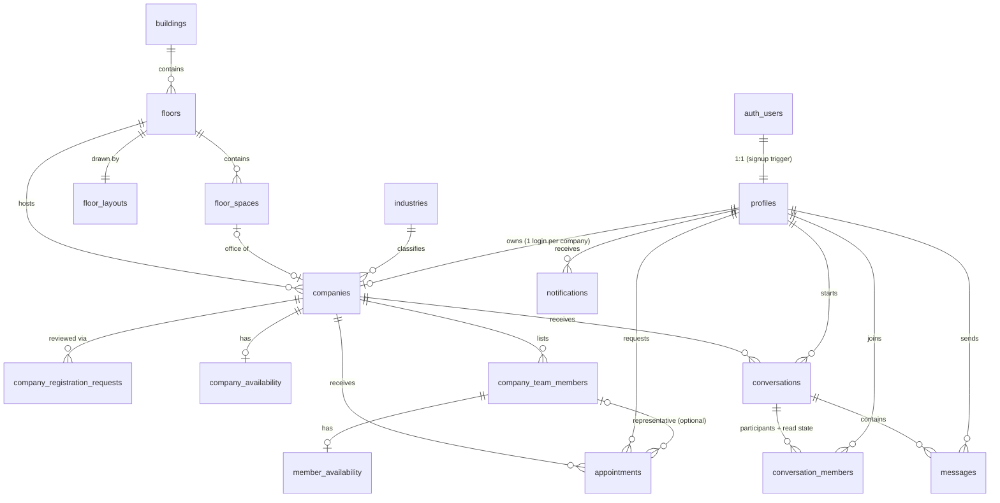

# Architecture

Startup Floor Connect is an interactive 2D virtual floor for an incubator building. Visitors explore an
SVG floor plan, discover the companies in each office, and contact them by chat, email or appointment
request.

## Stack

| Concern     | Choice                                                                      |
| ----------- | --------------------------------------------------------------------------- |
| Framework   | Next.js 16 (App Router, Cache Components, `proxy.ts`), React 19, TypeScript |
| Styling     | Tailwind CSS 4 with semantic design tokens (`src/app/globals.css`)          |
| Data / auth | Supabase: Postgres, Auth, Realtime, Storage                                 |
| Email       | Resend (server-side only)                                                   |
| Floor plan  | SVG rendered from database-stored geometry                                  |
| Tests       | Vitest; database tests run the real migrations on PGlite (Postgres in WASM) |
| Hosting     | Vercel + Supabase Cloud                                                     |

## Request flow

```
Browser ──► proxy.ts (refresh Supabase session cookie; optimistic only)
        ──► Server Components / Server Actions / Route Handlers
              └─ Supabase server client (user's JWT → RLS enforced)
              └─ Supabase admin client (secret key, server-only; used sparingly, caller authorized first)
        ──► Client Components
              └─ Supabase browser client (publishable key → RLS enforced)
              └─ Realtime subscriptions (messages, notifications, availability)
```

**Authorization lives in the database.** Every table has Row Level Security, and guard triggers protect
privileged columns. UI role checks only decide what to show; they are never the security boundary.

## Folder structure

```
supabase/
  config.toml              local Supabase settings (auth policy, redirect URLs)
  migrations/              ordered SQL migrations (schema → security → storage/realtime → feature RPCs)
  seed.sql                 local reference data: building, floor, layout, spaces, industries
scripts/
  generate-db-types.mts    offline type generator (migrations → src/types/database.ts)
src/
  app/                     routes (App Router)
    (public)/              floor map, directory, company profiles          [Phase 3–4]
    (auth)/                login, register, company registration          [Phase 2]
    account/               visitor area: conversations, appointments      [Phase 6–7]
    company/               company dashboard: profile, team, inbox        [Phase 3–7]
    admin/                 super admin dashboard                          [Phase 3–4]
    api/                   route handlers (health, email)
  components/
    ui/                    design-system primitives (button, input, badge, dialog …)
    layout/                header, footer, shells
    floor/                 SVG floor renderer, office shapes, zoom/pan    [Phase 4]
    company/ chat/ appointments/ admin/   feature components
  config/                  static app config (site metadata)
  lib/
    env.ts / env.server.ts validated environment (public vs server-only)
    supabase/              browser, server, admin and proxy clients
    floor/                 geometry schema + helpers
    auth/ companies/ appointments/ chat/  server-side data access + actions per feature
  types/database.ts        generated database types
  proxy.ts                 session refresh (Next 16 replacement for middleware)
tests/
  unit/                    pure TypeScript tests
  db/                      migration + RLS tests against PGlite
docs/                      architecture, checklist
```

## Data model



Key decisions:

- **Floors are data.** `floor_layouts.geometry` holds walls, corridors, common areas and entrances;
  `floor_spaces` holds every clickable space with its shape. Both are validated by
  `src/lib/floor/geometry.ts`. Adding a floor or building needs no code change.
- **One login per company.** `companies.owner_id` is unique. Team members are records the company
  manages, not accounts.
- **Placement integrity.** `companies.space_id` is unique (one company per office). A composite foreign
  key `(space_id, floor_id)` keeps the space on the company's floor, and a trigger only allows `office`
  spaces.
- **Availability is self-reported.** No availability row means _Unknown_. Rows carry `updated_at` and
  `updated_by`. Availability never implies a confirmed slot or physical presence.
- **Appointments.** Stored as UTC `starts_at` / `ends_at`, plus the requester's IANA `timezone` for
  display. Duration is 15 min to 4 h. A GiST exclusion constraint prevents overlapping **accepted**
  appointments for the same representative. A trigger enforces the status workflow (below).
- **Chat.** One conversation per (visitor, company). `conversation_members` holds the participants
  and their `last_read_at`, which gives unread counts. It also lets more company users join later
  without schema changes. Message timestamps are set by the server.
- **Notifications.** Written only by database triggers and server code; users can read them, mark
  them read, and delete them.

## Roles and permissions

| Role          | How assigned                                                  |
| ------------- | ------------------------------------------------------------- |
| Guest         | No session (`anon`)                                           |
| `visitor`     | Default at signup                                             |
| `company`     | Signup with `account_type: "company"` metadata                |
| `super_admin` | Manually, via SQL or service role. Never via signup metadata. |

| Resource                 | Guest           | Visitor          | Company account                              | Super admin         |
| ------------------------ | --------------- | ---------------- | -------------------------------------------- | ------------------- |
| Floors, layouts, spaces  | read            | read             | read                                         | full                |
| Companies                | read approved   | read approved    | read approved + own; edit own*               | full                |
| Team / availability      | read (approved) | read (approved)  | manage own                                   | full                |
| Registration requests    | –               | –                | submit + read own                            | review              |
| Profiles                 | –               | own (+ contacts) | own + people who contacted it                | read all, set roles |
| Conversations / messages | –               | own only         | own company's only                           | **no access**       |
| Appointments             | –               | own; cancel      | own company's; accept/reject/complete/cancel | read, manage        |
| Notifications            | –               | own              | own                                          | own                 |
| Storage (logos, avatars) | public URLs     | public URLs      | write `<company_id>/…` folder                | full                |

\* Owners cannot change `status`, `slug`, `owner_id`, `floor_id` or `space_id`. Those are reserved
for super admins, and a guard trigger enforces it. New companies are always created as `pending`.

Appointment status workflow (trigger-enforced):

```
            company accepts          company completes (after start)
 pending ───────────────► accepted ─────────────────────────────► completed
    │  company rejects        │
    ├──────────► rejected     │ company or requester cancels
    │ requester cancels       ▼
    └──────────────────────► cancelled
```

## Environment variables

| Variable                               | Scope       | Purpose                                           |
| -------------------------------------- | ----------- | ------------------------------------------------- |
| `NEXT_PUBLIC_SUPABASE_URL`             | public      | Supabase API URL                                  |
| `NEXT_PUBLIC_SUPABASE_PUBLISHABLE_KEY` | public      | Publishable (or legacy anon) key; RLS applies     |
| `SUPABASE_SECRET_KEY`                  | server only | Secret (or legacy service_role) key; bypasses RLS |
| `NEXT_PUBLIC_SITE_URL`                 | public      | Absolute URL for auth redirects and email links   |
| `NEXT_PUBLIC_DEFAULT_TIMEZONE`         | public      | Fallback display timezone (`Asia/Kolkata`)        |
| `RESEND_API_KEY`                       | server only | Transactional email (Phase 7)                     |
| `EMAIL_FROM`                           | server only | Verified sender address (Phase 7)                 |

`src/lib/env.ts` validates the public variables. `src/lib/env.server.ts` holds the server-only
secrets and imports `server-only`, so the build fails if a Client Component imports it.
